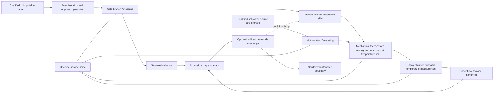

# Luminous Aqua — AQS-1 Interface and Fault Contract v0.1

**Status:** conceptual engineering contract for an unoccupied reference test article; not a P&ID, construction drawing, product specification, or approval  
**Parent work:** [AQUA-MODULAR-PLATFORM-001 #12717](https://github.com/Luminous-Dynamics/symthaea/issues/12717)  
**Programme:** [AQUA-BATHING-SERVICE-001 #12660](https://github.com/Luminous-Dynamics/symthaea/issues/12660)

## 1. Why this is a different product architecture

AQS-1 is not a collection of premium fixtures controlled by an app. It is a **serviceable bathing module** whose measurable outcome is a completed task with known water, energy, thermal, room, maintenance and evidence costs.

The architectural shift is from:

- fixture flow rating → litres and purchased energy per completed task;
- component efficiency → useful heat actually delivered to the receiving system;
- concealed plumbing → inspectable, isolatable and replaceable wet-side cartridges;
- smart-home dependency → local physical safety and manual service that remain functional without software, cloud or internet;
- a single undifferentiated pipe network → physically distinct, labelled circuits with explicit owners;
- nominal performance → matched tests at declared pressure, inlet temperature, room condition, task and maintenance state.

The first test article deliberately excludes shower recirculation, bidet, whirlpool, pool, plunge, steam and sauna. These add different exposure, treatment, electrical, thermal, envelope and maintenance obligations. They remain separate modules and qualification classes.

## 2. AQS-1 bounded configuration

**Included in the first reference article**

1. Direct-flow shower with fixed and handheld delivery options.
2. Serviceable basin with replaceable outlet/aerator and accessible trap.
3. Dry-side service spine containing accessible isolation, measurement taps, replaceable strainers and service interfaces.
4. A qualified hot-water source (resistance or heat-pump storage) selected for the test site.
5. Optional **indirect** drain-water heat recovery (DWHR) test branch with a physical bypass.
6. Local manual controls and independent mechanical/physical temperature protection.
7. Separate sanitary drain and, where a site uses it, a physically separate WaterLoop intake boundary.

**Explicitly excluded**

- Any within-session or cross-session human-use water recirculation.
- Greywater, pool, spa, rainwater or non-potable fluid feeding a bathing or handwashing outlet.
- Any direct fluid connection between wastewater and potable supply.
- AI/cloud control of temperature limits, shutoff, backflow protection, treatment release or emergency isolation.
- Steam, sauna, plunge, pool or fountain loads in the first room test cell.

## 3. Conceptual system flow

The sketch below names interfaces only. It is not a pipe-size, valve, backflow, electrical, pressure-rating or installation instruction; those require controlled design by qualified local professionals.

The exchanger transfers heat across a qualified barrier; it does not join the fluid circuits. A DWHR failure or loss of confidence in exchanger integrity results in physical isolation/bypass and ordinary once-through operation, not a software judgement.

## 4. Interface register

| ID | Boundary / interface | Required observations | Fault containment / authority |
|---|---|---|---|
| CW-0 | Incoming potable cold supply | pressure, temperature, flow, source condition | Site plumbing and source owner; isolate on leak or out-of-envelope supply |
| CW-1 | Cold distribution / branch | pressure drop, flow, temperature, configuration | Qualified plumbing design; no unknown cross-connection |
| HW-0 | Hot-water source and storage | delivered temperature, source input energy, storage state/loss | Heater manufacturer and qualified installer; source high-limit remains independent |
| MX-0 | Mechanical mixing / temperature protection | mixed outlet temperature, response, failure position | Physical/mechanical protection owns safe temperature; software cannot raise its limit |
| SH-0 | Shower delivery | flow, dynamic pressure, outlet temperature, spray field | Aqua service contract; pressure/temperature measurement admitted by Mycelix |
| BS-0 | Basin outlet and trap | flow, splash, task result, drainability and access | Aqua washstation profile; service parts accessible |
| DW-0 | Shower/basin drain | drain flow, blockage, retained water, cleanout access | Sanitary drainage authority; overflow or blockage triggers stop/isolation |
| HX-0 | DWHR primary (drain) side | inlet/outlet temperature, flow, pressure loss, fouling state | Symtropy thermal owner; physical bypass and service isolation |
| HX-1 | DWHR secondary (potable) side | inlet/outlet temperature, flow, pressure loss | Indirect heat transfer only; integrity and potable protection reviewed by qualified parties |
| EL-0 | Electrical supply to any powered equipment | branch energy, protective state, fault state | Qualified electrical design; no exposed or unreviewed wet-zone electrical assembly |
| IAQ-0 | Room air / moisture boundary | temperature, relative humidity, surface temperature, airflow | Symtropy room integration plus qualified HVAC/envelope owner |
| OBS-0 | Optional local instrumentation / Symthaea | data age, sensor quality, device/configuration identity | Read-only observation and bounded advice; absence or error cannot defeat physical protection |

The final interface schedule must add actual material compatibility, connection class, flow direction, operating envelope, isolation location, sampling/measurement point, cleaning method, service clearance and responsible sign-off. No dimensions or pressure/temperature ratings are inferred from this conceptual table.

## 5. Measurement topology and evidence

### Water service

- Meter the potable inlet and each separately operated fixture branch.
- Measure dynamic pressure at the declared supply and delivery points, not only static pressure.
- Record inlet, mixed and outlet temperatures with calibrated sensors and synchronized timestamps.
- Account for startup/warm-up, active use, pauses, shutdown, cleaning and purge.
- Record drain-side volume and any DWHR bypass, reject or leakage separately.
- Preserve raw observations, calibration, uncertainty, clock quality and protocol revision.

### Thermal and electrical service

- Meter purchased energy at the hot-water source and any DWHR pump or control parasitic loads.
- Meter useful heat at the receiving boundary; do not equate exchanger temperature effectiveness with recovered system energy.
- Record storage, distribution, room and drain losses where the selected accounting boundary requires them.
- Close mass and energy residuals against the declared measurement uncertainty; an unexplained residual is **unknown**, not zero.

### Task and maintenance service

- Freeze task profile, duration window, body/task coverage protocol and room conditions before matched testing.
- Capture spray coverage, force distribution, outlet temperature stability, splash, time-to-task, task completion and user-reported comfort.
- Log every intervention: filter/nozzle cleaning, scale removal, cartridge replacement, cleaning chemical, labour minutes, tools, consumables and downtime.
- Record installed configuration, hardware revision, firmware (if any), nozzle geometry, cleaning protocol, calibration and evidence receipt digests.

Mycelix owns metrology admission and water-quality assessment. Symtropy owns its water-service, physical resource-closure and thermal model outputs. Aqua binds those authoritative results to the product/task comparison; it does not recalculate or certify them.

## 6. Matched benchmark contract

An AQS-1 result is comparable only when the control and candidate share the same:

- user/task profile and task duration window;
- inlet-water profile and supply boundary;
- pressure test points and dynamic pressure trace protocol;
- inlet-water temperature and room conditions;
- measurement system, calibration method and uncertainty rules;
- task scoring method and cleaning / maintenance accounting boundary.

Device geometry, nozzle, filter, hardware, cleaning method and service interventions are allowed to differ, but must be fully versioned and counted as product characteristics. Run order should be randomized or otherwise counterbalanced where practical. The endpoint assessor should be blinded to candidate identity where practical.

**Primary outcome:** successful bathing service at equal or pre-registered non-inferior task quality.

**Resource outcomes:** litres per successful service; purchased kWh per successful service; useful recovered heat; cleaning/purge water; parasitic electricity; maintenance labour; consumables; replacement parts; service downtime; lifecycle cost.

A flow-only score is insufficient. Reducing flow while making the user extend the shower, repeat a task or remove a flow restrictor is not a service improvement.

## 7. Initial benchmark targets — hypotheses, not achievements

| Dimension | AQS-1 target / comparison | Gate |
|---|---|---|
| Shower flow | Primary engineering target ≤6.0 L/min at 300 kPa; stretch ≤4.5 L/min | Only passes with non-inferior spray field, temperature stability, task completion and user outcome |
| Pressure robustness | Characterize at 150 and 300 kPa; optional higher-pressure characterization only within every component's rated envelope | No extrapolation from one pressure point; no unsafe pressure test |
| Spray quality | Map spatial coverage and impact-force distribution, not just flow | Pre-register equivalence/non-inferiority method and measurement uncertainty |
| Complete-service water | Include startup, active shower, pause, shutdown, cleaning and purge | Report L/successful task and every excluded flow explicitly |
| Basin | Benchmark handwashing/grooming at matched user/task and 150/300 kPa where applicable | Flow, splash, task time, temperature, cleanability and drain performance together |
| DWHR | Stretch objective ≥60% useful system-level heat recovery after losses, parasitics, fouling and maintenance | Report source, exchanger and whole-system boundaries separately; optional module only |
| Reliability | No critical leak, scald, cross-connection or unsafe actuation in any qualification sequence | Any critical fault blocks progression; endurance cycle count is set by the hazard and product plan |
| Repairability | Every expected wear/scale item can be isolated, inspected, cleaned or replaced without destructive wall access | Timed technician task and documented tool/part list |
| Privacy and control | Core function without camera, microphone, cloud or phone; local manual path always available | Loss of network/AI/power cannot defeat safe isolation or physical limits |
| Evidence | Complete owner receipts for all required measurands and tasks | Missing/stale/calibration-invalid evidence → unknown / no qualification |

### Why these targets are worth testing

The South African CLASP/WRC evidence shows that pressure-compensating showerheads averaged about 6.6 L/min at 300 kPa in the referenced 19-product sample, while fixed-orifice models averaged roughly 24–27 L/min; the study and WRC synthesis also warn that inadequate spray quality can drive longer showers or removal of regulators. This makes 6.0 L/min a meaningful *test hypothesis* locally, not a universal product promise. [CLASP report](https://www.clasp.ngo/research/all/south-african-shower-heads-testing-report/) · [WRC synthesis](https://www.wrc.org.za/wp-content/uploads/mdocs/WW%20July%20-%20Sept%202025_web.pdf)

The U.S. WaterSense comparator is ≤2.0 US gpm (about 7.6 L/min) and independently evaluates spray force, coverage and pressure compensation. Aqua should compete on completed service and pressure robustness, not simply advertise a lower nominal flow. [EPA showerhead criteria](https://www.epa.gov/watersense/showerheads)

For recirculation comparison only, KOHLER's EvoCycle page advertises up to 80% savings with 0.5 gpm fresh water blended into a 2.5 gpm delivery. The same page describes a 0.75-US-gallon Rapid Clean cycle recommended after each shower. Thus any fair service ledger must include cleaning water, not just the active shower. This is a manufacturer claim, not independent evidence of hygiene or comparative field performance. [KOHLER EvoCycle](https://www.kohler.com/en/products/showers/anthem-evocycle)

A 14-month field study of a commercial shower drain heat-recovery exchanger reported 66% exchanger efficiency after fouling and unsteady effects, but 52% overall system efficiency after shower heat losses between head and drain. A 2026 whole-DHW-system study reports study-specific global COP up to 6.3 experimentally and 8.0 in simulation, and emphasizes heater, tank and DWHR topology together. These results justify whole-system topology tests; they are not transferable performance guarantees. [2025 in-situ DWHR study](https://doi.org/10.1016/j.enbuild.2025.115341) · [2026 DWHR/HP study](https://doi.org/10.1016/j.enbuild.2026.117761)

A 2026 shower-system review recommends assessing opportunistic pathogens across water, biofilms and aerosols and across hoses, heads and pipes. For that reason AQS-1 does not use a low-flow or clear-water appearance as a proxy for hygienic qualification; human-use recirculation remains out of scope until independent, use-specific exposure assessment is complete. [2026 review](https://doi.org/10.1016/j.jes.2026.02.034)

## 8. Fault contract and stop conditions

| Fault / unknown | Required immediate response | Requalification before return |
|---|---|---|
| Leak, unexpected water presence or pressure decay | Local physical isolation; stop affected service | Inspect joint/part, document cause and repair, pressure/leak test |
| Mixed outlet temperature outside declared safe envelope | Independent physical high-limit / shutoff; stop delivery | Verify sensor and mechanical protection independently |
| Stuck valve or mixer | Fail to the professionally determined safe state; manual isolation accessible | Replace/repair and exercise full fault sequence |
| Blocked drain, overflow or retained standing water | Stop affected fixture; isolate and clear safely | Drainage, trap and wet-path inspection |
| Backflow/cross-connection suspicion | Isolate affected circuits; no service release | Qualified backflow/cross-connection inspection and required testing |
| DWHR integrity concern, unexpected pressure loss or contamination suspicion | Physically bypass/isolate DWHR; retain once-through service only if otherwise safe | Qualified integrity inspection and pressure/thermal re-test |
| Filter/nozzle clogging or scale | Degrade only within an explicitly qualified service envelope; otherwise stop/clean | Record intervention and repeat spray/flow performance check |
| Sensor stale, missing, contradictory or calibration invalid | Mark observation unknown; do not let software infer safe state | Repair/calibrate and repeat the affected measurement protocol |
| Power, network, app or Symthaea loss | Manual/local physical operation remains; AI/cloud are not safety dependencies | Verify no unintended actuator state and local fallback |
| Unexplained evidence residual or missing owner receipt | No comparative performance claim / no qualification progression | Reconcile raw records and obtain owner-authorized evidence |

The hazard analysis must be tailored to the exact test article and jurisdiction by qualified plumbing, electrical, HVAC and product-safety professionals. This table is a design input, not a completed FMEA or safety case.

## 9. Unoccupied test sequence and release gates

1. **Configuration freeze:** exact test article, flow path, materials, nozzle, valves, instrumentation, task protocol and accounting boundary recorded.
2. **Metrology gate:** calibrated instruments, timebase, uncertainty and measurement points admitted by the relevant owner.
3. **Cold hydraulic characterization:** static/dynamic leakage, pressure drop, flow, drain capacity and isolation behavior, in an unoccupied and professionally reviewed test rig.
4. **Thermal characterization:** cold-start, draw profile, temperature response, high-limit actuation, storage/source behavior and any DWHR bypass modes.
5. **Spray-field characterization:** coverage/force mapping at declared pressure points and inlet conditions; no human exposure required.
6. **Fault injection:** leak, low/high supply pressure within safe test limits, blocked drain, sensor loss, stuck valve, power/network loss and DWHR bypass; exact stop behavior recorded.
7. **Repeated-service / maintenance sequence:** fouling/scale surrogate where technically appropriate, cleaning, inspection, cartridge change and performance re-test.
8. **Matched-service comparison:** randomized/counterbalanced control vs candidate; task endpoint and uncertainty method frozen before unblinding.
9. **Independent review:** specialist owners review their own evidence; Aqua only composes qualified results.

No occupied use, public pilot, human recirculation, procurement, build or regulatory claim follows automatically from completion of an unoccupied test. Those decisions require separate approvals and risk reviews.

## 10. What would count as a real breakthrough

AQS-1 should beat incumbent products on a **Pareto frontier**, not on one marketing number. The strongest result would demonstrate, in the same matched test:

- lower litres per successful shower at equal task quality;
- lower purchased kWh per successful service, after all source/storage/ventilation/pumping effects in scope;
- lower maintenance time and easier repair;
- stable performance at low supply pressure and after realistic fouling;
- better local serviceability, user agency and offline resilience;
- a complete and independently reviewable evidence trail.

Do not claim superiority if one dimension improves by silently worsening comfort, hygiene, accessibility, reliability, cleaning burden or lifecycle cost. A failure to beat a baseline is still useful if the benchmark is clean, reproducible and identifies the limiting mechanism.

## 11. Claim ceiling

This is a conceptual interface and fault contract. It is not a detailed P&ID, hydraulic calculation, thermal model, completed FMEA, qualified water-quality system, electrical/plumbing installation design, accessibility certificate, measured saving, reliability result, product release or construction approval.
