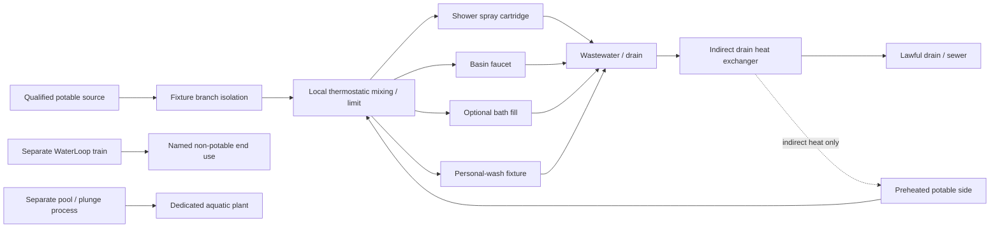

# Luminous Aqua — Modular Platform Architecture v0.1

**Status:** product architecture reference; not a dimensioned design or construction release  
**Parent:** [AQUA-BATHING-SERVICE-001 #12660](https://github.com/Luminous-Dynamics/symthaea/issues/12660)  
**Related:** #12692 shower spray, #12693 washstation, #12694 thermal suite, #12702 wet-room envelope, #12703 wet-path hygiene, #12709 DHW cascade, #12712 adaptive experience.

## Product thesis

Luminous Aqua should be a **family of serviceable bathing modules**, not a single expensive smart bathroom appliance.

The product is built from three separable assemblies:

1. **Fixture cartridges** — the user-facing shower, bath, bidet, basin, sauna/steam/plunge/pool/water-feature modules.
2. **Service spine** — accessible isolation, mechanical valves, strainers, traps, meters, indirect heat exchanger interfaces, replaceable wet-path components and diagnostics.
3. **Local experience / evidence layer** — manual controls first, local bounded logic, optional Symthaea recommendations, Mycelix measurement/provenance, Symtropy physical-result interfaces, Sol-Atlas site/water-feature context and Luminous evidence receipts.

A product can be installed with no Symthaea connection, no cloud account, no camera, no microphone and no personal profile. Essential bathing service and independent safety functions still work.

## Reference system for the first physical design article

The first engineering article should be deliberately modest:

- one direct-flow shower head + handheld, using replaceable spray/nozzle cassette;
- one basin / grooming tap;
- separate toilet and personal-wash branch only after local backflow and installation review;
- a thermostatic / temperature-limiting control path with mechanical fallback and independent safety limit;
- a dry-side service spine containing labelled isolation, strainers, unions, drain/cleanout access and metrology taps;
- an indirect shower-drain heat-recovery test interface with bypass and isolation; no drain-to-potable water mixing;
- source, fixture, drain and thermal metering boundaries compatible with Mycelix/Symtropy owner channels;
- local manual control with optional Symthaea read-only observation and recommendation.

**Not in the first article:** human recirculating shower use, greywater treatment, public/bathing fountain, pool, steam, sauna or plunge operation. These are separate products and evidence classes.

## Physical architecture

### A. Water circuit classes

| Circuit | Purpose | Permitted boundary | Prohibited shortcut |
|---|---|---|---|
| Potable supply | shower, bath fill, basin, bidet/personal wash | qualified local plumbing, backflow and source integrity | no connection to drain, pool, immersion or greywater |
| Within-session recirculation | optional future same-user shower loop | a dedicated, isolated same-session research path with independent exposure qualification | no retained water between users; no automatic greywater credit |
| Greywater / non-potable reuse | WaterLoop treatment and named non-potable use | WaterLoop source-specific treatment, quality and delivery authority | no Aqua software bypass, no bidet or bathing use without a distinct approved use case |
| Pool / plunge / whirlpool | aquatic immersion / treatment | Sol-Atlas thermal and aquatic owner context plus competent water-quality authority | no shared piping with potable/bathing fixtures |
| Drain / wastewater / reject | wastewater, purge, backwash, cleaning and reject streams | lawful discharge, accessible cleanout and complete resource accounting | no drain-to-potable or hidden discharge |

### B. Simplified flow separation

The dotted thermal transfer represents heat only across a physically separated heat exchanger; no drain water enters a potable circuit.

### C. Thermal paths

- Heater / heat-pump / storage source supplies the qualified hot-water service.
- Shower or bath drain supplies low-grade heat through an indirect exchanger only.
- Mixer-side, balanced and tank-side topologies are compared under [DHW cascade #12709](https://github.com/Luminous-Dynamics/symthaea/issues/12709); no one topology is assumed best.
- Heat pump / dehumidifier / exhaust-air recovery may exchange heat with a separate closed loop only where Symtropy's exergy/thermal model and qualified design permit.
- Pool or water-feature heat exchange remains with Sol-Atlas #765/#766/#770/#772 and its finite demand/headroom ledger.

Recovered heat is credited at the useful receiving boundary after parasitic electricity, pressure loss, fouling, tank/pipe loss and time mismatch. Never credit it once at the exchanger and again at the heater.

## Fixture module contracts

| Module | Replaceable / inspectable subassemblies | Product-specific test owner |
|---|---|---|
| Shower | spray/nozzle cassette, faceplate, hose, handpiece, strainer, seals, thermostat cartridge | #12692 plus #12703 |
| Bath | vessel, fill/spout, waste, overflow, access panel, optional separate jet module | #12693 plus #12703 |
| Bidet / personal wash | nozzle, retract mechanism, hose, filter, valve, seat/control and service cartridge | #12693 plus #12703 |
| Basin | aerator / laminar outlet, cartridge, trap, overflow, strainer, service unions | #12693 plus #12703 |
| Dry sauna | heater, stones, guards, seating, ventilation and independent high limit | #12694 |
| Steam / hammam | generator, steam outlet, feed treatment, condensate and drain/cleanout modules | #12694 plus #12702/#12703 |
| Cold plunge / whirlpool | vessel, circulation, filtration, treatment, sampling points and drain-down | #12694 plus #12703 |
| Bathing fountain | jet/spray cartridge, collection/drain, barrier, anti-slip surfaces, access and source/process boundary | #12694 plus Sol-Atlas pool/water-feature owners |
| Pool / natatorium | pool circuit, filtration/treatment, heat exchange, envelope and HVAC interfaces | Sol-Atlas #765/#766/#770/#772; Aqua integrates the product room only |

A replaceable cartridge is not a hygienic pass by itself. The cleaning method, post-clean inspection, sampling and requalification path must be tested.

## Service spine and interfaces

The service spine should be reachable from a dry maintenance side wherever site geometry permits. It should group:
- labelled potable branch isolation and pressure/temperature measurement taps;
- fixture-side unions, strainers and replaceable valves;
- drain cleanout, overflow and trap access;
- indirect DWHR cleanout, bypass and pressure-loss measurement;
- optional future same-session recirculation module isolation (not fitted or enabled by default);
- electrical isolation for powered fixture modules, outside wet user reach;
- ventilation / condensate service access for steam or wet-room add-ons;
- tamper-evident configuration and component identity labels.

Every physical connection should have a versioned interface entry with: medium class, direction, nominal/rated envelope, isolation method, drain-down/cleaning path, material compatibility, measurement boundary and owner evidence. This is an interface schedule, not a new generic telemetry or physical-connection ontology.

## Control and evidence authority

| Function | Authority |
|---|---|
| Manual fixture use / emergency shutoff | local mechanical or deterministic device control |
| Temperature / scald limits | independent local thermostatic and physical high-limit protection |
| Water-path isolation / treatment permissive | local interlock under qualified hardware/process design |
| Preference profile / task interpretation | optional Symthaea recommendation; user may decline |
| Water quality / use-class status | Mycelix #6100 and competent independent authority |
| Instrument identity / calibration / uncertainty | Mycelix #6025/#6029/#6034/#6048/#6054/#6057 |
| Thermal / hydraulic / room physical models | existing Symtropy domain owners |
| Pool / water-feature thermal and microclimate | Sol-Atlas #765/#766/#770/#772 |
| Evidence receipt composition / product interface | Luminous Platform / Aqua product contract |

Unknown, stale, contradictory or out-of-envelope evidence cannot be interpreted as approval. AI cannot override interlocks, temperature limits, water quality, emergency isolation or user choice.

## Product configurations

### AQS-1 — Essential / compact
Shower + basin, with optional bidet/personal wash after local professional review. Prioritize a repairable service spine, direct-flow efficiency and reliable low-pressure operation.

### AQS-2 — Accessible / all-age
AQS-1 fixture modules plus reachable controls, seated/assisted shower option, transfer-compatible layout, step-free drainage, mechanical fallback and support anchorage defined by the applicable accessibility review.

### AQS-3 — Bathing / restorative suite
AQS-2 plus a separate bath and optional dry sauna / steam / plunge modules. Each has its own thermal, moisture, hygiene, electrical and egress envelope.

### AQS-4 — Shared / hospitality / community
Individually isolated shower bays, serviceable cartridges, dry-side plant, accessible routes, privacy/cleaning/maintenance workflows and separate aquatic treatment if pool or fountains are part of the facility.

These are product bundles, not four mutually exclusive styles or a one-size-fits-all floor plan.

## Design gates

1. Requirements and user journeys frozen for the named archetype.
2. Potable / recirculation / greywater / pool / wastewater diagram reviewed for the exact configuration.
3. All wet paths, retained volumes and cleanout/replaceable parts inventoried.
4. Local plumbing, electrical, backflow, accessibility, drainage, fire and building design review completed.
5. Thermal and ventilation boundaries mapped to existing Symtropy owners.
6. Owner-native measurement / water-quality / resource-closure contracts pinned.
7. Unoccupied room-scale and fixture bench at Symtropy #4531 with fault injection.
8. Independent human-factors and hygiene gates before any occupied or human-exposure trial.

## First stop / continue decision

Start with AQS-1 direct-flow shower + basin + service spine + optional indirect DWHR. Select direct-flow, nozzle geometry and DWHR topology using matched evidence. Advance to bidet and bath modules only after the first fixture interfaces and wet-path cleaning design are stable. Add recirculation / aquatic / steam / sauna only after independent class-specific hygiene, electrical, thermal and exposure reviews.

## Claim ceiling

This architecture is a modular design reference, not a released product, approved plumbing/electrical plan, certified accessible layout, validated water-quality system, measured efficiency result or authorization to purchase/build/occupy. All product modules remain subject to their own qualification and applicable local review.

## AQS-1 interface and fault contract

The first direct-flow reference article's interface register, measurement topology, matched-service test gates, fault/stop contract and unoccupied validation sequence are defined in [AQUA_AQS1_INTERFACE_AND_FAULT_CONTRACT_V0_1.md](AQUA_AQS1_INTERFACE_AND_FAULT_CONTRACT_V0_1.md). It is a conceptual engineering contract, not a released P&ID, construction design, completed FMEA or approval.

## Bounded bathing service compiler

The optional experience layer may translate an explicit user-selected task into an inspectable candidate plan using only exact, qualified fixture capabilities. The plan is advisory; it cannot control or widen physical limits, authorize water use or replace manual operation. The schema, abstention rules, negative controls and baseline comparison protocol are defined in [AQUA_BOUNDED_BATHING_SERVICE_COMPILER_V0_1.md](AQUA_BOUNDED_BATHING_SERVICE_COMPILER_V0_1.md), tracked in [#12749](https://github.com/Luminous-Dynamics/symthaea/issues/12749).

## Essential-service continuity

AQS-1 is also evaluated under declared water-pressure, water-supply, electrical, communications and evidence disturbances. The product must distinguish qualified reduced service, manual-only operation, isolated stop and recovery-pending states. Continuity cannot override safety or source-quality requirements. See [AQUA_ESSENTIAL_SERVICE_CONTINUITY_PROTOCOL_V0_1.md](AQUA_ESSENTIAL_SERVICE_CONTINUITY_PROTOCOL_V0_1.md) and [#12760](https://github.com/Luminous-Dynamics/symthaea/issues/12760).

## Spray-field design of experiments

The nozzle/manifold geometry work is now governed by a preregistered sequential DOE: comparator and metrology repeatability, manufacturable factor screening, response-surface refinement only after interaction review, robustness challenges, and an independent confirmation holdout. See [AQUA_SPRAY_GEOMETRY_DOE_PROTOCOL_V0_1.md](AQUA_SPRAY_GEOMETRY_DOE_PROTOCOL_V0_1.md) and [#12772](https://github.com/Luminous-Dynamics/symthaea/issues/12772). The first candidates remain passive zoned manifolds and replaceable nozzle cassettes; powered/AI-controlled zones do not precede proof of a passive-field advantage.

## Johannesburg deployment boundary — non-municipal and greywater sources

The City of Johannesburg Water Services By-laws 2023 are relevant to any Johannesburg AQS installation that proposes rainwater harvesting, borehole water or greywater reuse. Sections 69–71 set a fitness-for-purpose / alternative-source framework; sections 73–74 provide distinct rules for rainwater and greywater.

- Section 73 requires rainwater-harvesting facilities to be installed by a professionally registered plumber, prohibits rainwater use for drinking or other potable purposes unless it meets applicable drinking-water requirements, prohibits blending harvested rainwater with municipal supply, and requires cross-connection safeguards where both are used indoors. Rainwater-tank overflow is directed to stormwater drainage.
- Section 74 addresses greywater reuse for uses excluding drinking. Greywater tank installations must meet the stated building requirements; stored greywater must not create a public nuisance and must be filtered and disinfected to a written specification by a water specialist. The by-law directs greywater storage-tank overflow to the sewer.
- Sections 57 and 59–60 address compliance / demand management, the prohibition of equipment considered wasteful by a designated officer, and unlawful wastage.

These local provisions do not authorize greywater or rainwater for bathing. They reinforce the architecture rule: physically separate non-potable and potable circuits, no blending, no software-controlled crossover, and a source/use-class decision from the competent authority. The exact installation, approvals and applicability must be checked with the City and registered local professionals.

Primary source: [City of Johannesburg Water Services By-laws 2023, Local Authority Notice 980 of 2023](https://joburg.org.za/documents_/Documents/By-Laws/2023/City%20of%20Johannesburg%20Water%20Services%20Bylaws_%202023%20Gazette.pdf).

## Low-pressure installation design and test envelope

Aqua no longer treats 150 kPa as its lowest research pressure. SANS 10252-1:2018 Edition 3.2 Table 3 lists a 50–100 kPa design flow-pressure range for a water-saving showerhead at 10 L/min design flow, and other fixture-specific flow-pressure references for basins, baths and bidets. This motivates additional low-head research at 50 / 75 / 100 kPa; it does not establish that any given fixture is qualified at those pressures. Exact pressure datum and dynamic pressure at the fitting inlet must be recorded.

The same edition's amended clause 5.3.3.2 states a 10 L/min maximum discharge. Table 3's 12 L/min likely-maximum value is a separate user-demand planning quantity (footnote a), not necessarily an attainable product flow and not permission to exceed the clause-level limit. The Table 3 50–100 kPa design pressure is used where manufacturer flow-pressure curves are unavailable (footnote b); it motivates low-head research but is not a universal product pressure rating.

Track the dedicated low-pressure programme in [AQUA-LOW-PRESSURE-001 #12784](https://github.com/Luminous-Dynamics/symthaea/issues/12784).

## Software continuity evaluator

The product-level continuity vocabulary now has a deterministic Rust implementation in `symthaea-aqua-bench::service_continuity`. It consumes externally supplied owner-qualified state and reports the highest already-qualified mode. It cannot actuate isolation, create a reduced mode, override local protection, or clear requalification requirements. The protocol and negative tests are documented in [AQUA_ESSENTIAL_SERVICE_CONTINUITY_PROTOCOL_V0_1.md](AQUA_ESSENTIAL_SERVICE_CONTINUITY_PROTOCOL_V0_1.md).

## Low-pressure validation protocol

The detailed pressure-run matrix, pressure datum definitions, comparator admission rules and unoccupied sequence are now specified in [AQUA_LOW_PRESSURE_VALIDATION_PROTOCOL_V0_1.md](AQUA_LOW_PRESSURE_VALIDATION_PROTOCOL_V0_1.md), tracked by [#12784](https://github.com/Luminous-Dynamics/symthaea/issues/12784). It distinguishes static, upstream residual and dynamic fitting-inlet pressure and treats out-of-declared-range competitor tests as exploratory only.

## Task-selective delivery research

Aqua will benchmark low-flow base service with explicitly user-authorized, locally qualified task-specific bursts rather than assume a boost button is novel. Hansgrohe WaterBoost SKU 28036000 is an existing commercial precedent; its public page contains an unresolved 4 L/min regulator / maximum versus 6.6 / 9.4 L/min boost-flow scope ambiguity. The evidence corpus preserves the ambiguity, and the task-phase protocol requires independent reproduction before using the boosted figures as matched performance points. See [AQUA_TASK_SELECTIVE_DELIVERY_PROTOCOL_V0_1.md](AQUA_TASK_SELECTIVE_DELIVERY_PROTOCOL_V0_1.md) and [#12798](https://github.com/Luminous-Dynamics/symthaea/issues/12798).

## Pressure independence and transient supply response

AQS-1 now distinguishes steady-state pressure independence from dynamic supply response. The UK non-domestic ETL reference uses a 3 bar / 1.5 bar flow-retention comparison with a 60% minimum under stated conditions; Aqua's proposed 70% initial / 80% stretch are internal research targets using conservative measurement-uncertainty bounds, not certification claims. Exact-point same-specimen comparison is implemented in pressure_curve. See the updated low-pressure protocol and competitor ledger.

Dynamic events—startup, pressure steps, concurrent basin/bath draw, pump/regulator cycling, hot/cold interruptions and restoration—are covered separately by [AQUA_DYNAMIC_SUPPLY_TRANSIENT_PROTOCOL_V0_1.md](AQUA_DYNAMIC_SUPPLY_TRANSIENT_PROTOCOL_V0_1.md) and [#12801](https://github.com/Luminous-Dynamics/symthaea/issues/12801). No steady-state flow ratio is used to infer transient performance.

## Versioned external evidence corpus

The machine-readable evidence register now includes the UK ETL non-domestic shower criteria alongside exact Brondell and Hansgrohe product declarations, WaterSense criteria, SANS installation references and peer-reviewed spray studies. The corpus distinguishes programme criteria from manufacturer declarations and from Aqua results: [AQUA_EVIDENCE_CORPUS_V0_1.md](research/AQUA_EVIDENCE_CORPUS_V0_1.md), source JSON at [aqua-evidence-corpus-v0.1.json](research/aqua-evidence-corpus-v0.1.json). Current snapshot: 15 entries / 77 claims, including EN 18021:2025, UWL 2023 pressure-method criteria, UK ETL electric-shower wastewater-heat-recovery pathways and peer-reviewed 2025/2026 DWHR system studies. This is an evidence register, not certification.

## Power-coupled electric shower and DWHR architecture

The UK ETL's 15 September 2026 update establishes a non-domestic pathway for electric showers: 4.5 L/min standard maximum; up to 9 L/min when electrical input is modulated to minimize energy while maintaining stable output temperature with ETL-compliant wastewater heat recovery; and up to 10.6 L/min where qualifying user-behaviour features are also present. Aqua treats this as an architecture research reference only. It does not imply South African compliance or product eligibility. The complete measured service boundary must include heater electricity, actual receiver-side recovered heat, fresh water, fouling, static losses, parasitics, temperature stability and task completion.

See [AQUA_POWER_COUPLED_SHOWER_DWHR_BENCHMARK_V0_1.md](AQUA_POWER_COUPLED_SHOWER_DWHR_BENCHMARK_V0_1.md) and [#12816](https://github.com/Luminous-Dynamics/symthaea/issues/12816).

## Formal shower test-method alignment

The Aqua evidence chain now records test-method datums explicitly. EN 18021:2025, UWL 2023, UK ETL, WaterSense and South African SANS references use distinct product categories and pressure conditions. The generic pressure_curve helper rejects cross-datum comparisons, but does not represent UWL's separate hot/cold inlet channels or ETL's faceplate-centre pressure channel. See [AQUA_METHOD_CROSSWALK_V0_1.md](AQUA_METHOD_CROSSWALK_V0_1.md) and [#12817](https://github.com/Luminous-Dynamics/symthaea/issues/12817). No certification or standards conformity is claimed.

## Method-specific pressure evidence contracts

The pressure/flow evidence layer is split by the actual measurement method. The generic pressure_curve module admits one explicit terminal-inlet or point-of-discharge channel and rejects cross-datum comparisons. The separate standard_methods module represents UWL hot/cold inlet channels and ETL's faceplate-centre P2 pressure, with separate measurement and calibration receipts. Neither module by itself constitutes a full standard-method test or certification. See [AQUA_METHOD_CROSSWALK_V0_1.md](AQUA_METHOD_CROSSWALK_V0_1.md).

## Task-selective delivery and formal boost qualification

AQS-1 now has a task-phase software contract for PREPARE, BASE_DELIVERY, OPTIONAL_BOOST, PAUSE, RINSE and RETURN_TO_READY. Any boost capability must be bound to the exact market variant, hardware configuration, delivery conditions, qualification method and current receipt; it must be locally controlled by an explicit user hold with qualified automatic return, and remain within its independently qualified duration limit. Symthaea can only present an advisory plan. It does not command valves or infer water/energy savings from nominal flow x time.

The UWL 2023 Clause 12.1 boost test is incorporated as a method-specific evidence contract. It checks regular flow Qreg, boosted Qboost, flow-control closure, reopening without boost and post-close Qmax; UWL requires Qmax = Qreg, Qboost < 2 x Qreg and Qreg listed on the scheme label. Aqua's validator preserves separate hot/cold Type 1 P2 inlet pressure and uncertainty. It does not certify product conformity.

See [AQUA_TASK_SELECTIVE_DELIVERY_PROTOCOL_V0_1.md](AQUA_TASK_SELECTIVE_DELIVERY_PROTOCOL_V0_1.md), [AQUA_METHOD_CROSSWALK_V0_1.md](AQUA_METHOD_CROSSWALK_V0_1.md), and [#12798](https://github.com/Luminous-Dynamics/symthaea/issues/12798).

## Repairability as a measured product property

The dry-side service spine is now paired with a fault/job manifest and evidence contract. A routine repair counts as non-destructive only after the part is accessed without finish removal, the post-repair functional check passes, and all required independent device, water-quality and metrology gates are complete. See [AQUA_REPAIRABILITY_SERVICEABILITY_PROTOCOL_V0_1.md](AQUA_REPAIRABILITY_SERVICEABILITY_PROTOCOL_V0_1.md) and [#12844](https://github.com/Luminous-Dynamics/symthaea/issues/12844). ISO 20887:2020 informs design-for-disassembly decisions; it sets no universal numeric repairability performance threshold.
