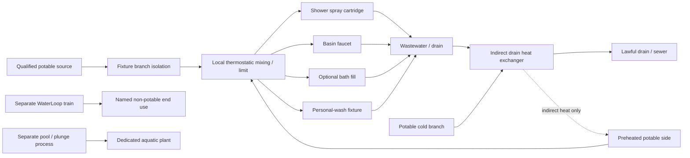

# Luminous Aqua — Modular Platform Architecture v0.1

**Status:** product architecture reference; not a dimensioned design or construction release  
**Parent:** [AQUA-BATHING-SERVICE-001 #12660](https://github.com/Luminous-Dynamics/symthaea/issues/12660)  
**Related:** #12692 shower spray, #12693 washstation, #12694 thermal suite, #12702 wet-room envelope, #12703 wet-path hygiene, #12709 DHW cascade, #12712 adaptive experience.

## 1. Product thesis

Luminous Aqua should be a **family of serviceable bathing modules**, not a single expensive smart bathroom appliance.

The product is built from three separable assemblies:

1. **Fixture cartridges** — the user-facing shower, bath, bidet, basin, sauna/steam/plunge/pool/water-feature modules.
2. **Service spine** — accessible isolation, mechanical valves, strainers, traps, meters, indirect heat exchanger interfaces, replaceable wet-path components and diagnostics.
3. **Local experience / evidence layer** — manual controls first, local bounded logic, optional Symthaea recommendations, Mycelix measurement/provenance, Symtropy physical-result interfaces, Sol-Atlas site/water-feature context and Luminous evidence receipts.

A product can be installed with no Symthaea connection, no cloud account, no camera, no microphone and no personal profile. Essential bathing service and independent safety functions still work.

## 2. Reference system for the first physical design article

The first engineering article should be deliberately modest:

- one direct-flow shower head + handheld, using replaceable spray/nozzle cassette;
- one basin / grooming tap;
- separate toilet and personal-wash branch only after local backflow and installation review;
- a thermostatic / temperature-limiting control path with mechanical fallback and independent safety limit;
- a dry-side service spine containing labelled isolation, strainers, unions, drain/cleanout access and metrology taps;
- an indirect shower-drain heat-recovery test interface with bypass and isolation; no drain-to-potable water mixing;
- source, fixture, drain and thermal metering boundaries compatible with Mycelix/Symtropy owner channels;
- local manual control with optional Symthaea read-only observation and recommendation.

**Not in the first article:** human recirculating shower use, greywater treatment, public/bathing fountain, pool, steam, sauna or plunge operation. These are separate products and evidence classes.

## 3. Physical architecture

### A. Water circuit classes

| Circuit | Purpose | Permitted boundary | Prohibited shortcut |
|---|---|---|---|
| Potable supply | shower, bath fill, basin, bidet/personal wash | qualified local plumbing, backflow and source integrity | no connection to drain, pool, immersion or greywater |
| Within-session recirculation | optional future same-user shower loop | a dedicated, isolated same-session research path with independent exposure qualification | no retained water between users; no automatic greywater credit |
| Greywater / non-potable reuse | WaterLoop treatment and named non-potable use | WaterLoop source-specific treatment, quality and delivery authority | no Aqua software bypass, no bidet or bathing use without a distinct approved use case |
| Pool / plunge / whirlpool | aquatic immersion / treatment | Sol-Atlas thermal and aquatic owner context plus competent water-quality authority | no shared piping with potable/bathing fixtures |
| Drain / wastewater / reject | wastewater, purge, backwash, cleaning and reject streams | lawful discharge, accessible cleanout and complete resource accounting | no drain-to-potable or hidden discharge |

### B. Simplified flow separation

The dotted thermal transfer represents heat only across a physically separated heat exchanger; no drain water enters a potable circuit.

### C. Thermal paths

- Heater / heat-pump / storage source supplies the qualified hot-water service.
- Shower or bath drain supplies low-grade heat through an indirect exchanger only.
- Mixer-side, balanced and tank-side topologies are compared under [DHW cascade #12709](https://github.com/Luminous-Dynamics/symthaea/issues/12709); no one topology is assumed best.
- Heat pump / dehumidifier / exhaust-air recovery may exchange heat with a separate closed loop only where Symtropy's exergy/thermal model and qualified design permit.
- Pool or water-feature heat exchange remains with Sol-Atlas #765/#766/#770/#772 and its finite demand/headroom ledger.

Recovered heat is credited at the useful receiving boundary after parasitic electricity, pressure loss, fouling, tank/pipe loss and time mismatch. Never credit it once at the exchanger and again at the heater.

## 4. Fixture module contracts

| Module | Replaceable / inspectable subassemblies | Product-specific test owner |
|---|---|---|
| Shower | spray/nozzle cassette, faceplate, hose, handpiece, strainer, seals, thermostat cartridge | #12692 plus #12703 |
| Bath | vessel, fill/spout, waste, overflow, access panel, optional separate jet module | #12693 plus #12703 |
| Bidet / personal wash | nozzle, retract mechanism, hose, filter, valve, seat/control and service cartridge | #12693 plus #12703 |
| Basin | aerator / laminar outlet, cartridge, trap, overflow, strainer, service unions | #12693 plus #12703 |
| Dry sauna | heater, stones, guards, seating, ventilation and independent high limit | #12694 |
| Steam / hammam | generator, steam outlet, feed treatment, condensate and drain/cleanout modules | #12694 plus #12702/#12703 |
| Cold plunge / whirlpool | vessel, circulation, filtration, treatment, sampling points and drain-down | #12694 plus #12703 |
| Bathing fountain | jet/spray cartridge, collection/drain, barrier, anti-slip surfaces, access and source/process boundary | #12694 plus Sol-Atlas pool/water-feature owners |
| Pool / natatorium | pool circuit, filtration/treatment, heat exchange, envelope and HVAC interfaces | Sol-Atlas #765/#766/#770/#772; Aqua integrates the product room only |

A replaceable cartridge is not a hygienic pass by itself. The cleaning method, post-clean inspection, sampling and requalification path must be tested.

## 5. Service spine and interfaces

The service spine should be reachable from a dry maintenance side wherever site geometry permits. It should group:
- labelled potable branch isolation and pressure/temperature measurement taps;
- fixture-side unions, strainers and replaceable valves;
- drain cleanout, overflow and trap access;
- indirect DWHR cleanout, bypass and pressure-loss measurement;
- optional future same-session recirculation module isolation (not fitted or enabled by default);
- electrical isolation for powered fixture modules, outside wet user reach;
- ventilation / condensate service access for steam or wet-room add-ons;
- tamper-evident configuration and component identity labels.

Every physical connection should have a versioned interface entry with: medium class, direction, nominal/rated envelope, isolation method, drain-down/cleaning path, material compatibility, measurement boundary and owner evidence. This is an interface schedule, not a new generic telemetry or physical-connection ontology.

## 6. Control and evidence authority

| Function | Authority |
|---|---|
| Manual fixture use / emergency shutoff | local mechanical or deterministic device control |
| Temperature / scald limits | independent local thermostatic and physical high-limit protection |
| Water-path isolation / treatment permissive | local interlock under qualified hardware/process design |
| Preference profile / task interpretation | optional Symthaea recommendation; user may decline |
| Water quality / use-class status | Mycelix #6100 and competent independent authority |
| Instrument identity / calibration / uncertainty | Mycelix #6025/#6029/#6034/#6048/#6054/#6057 |
| Thermal / hydraulic / room physical models | existing Symtropy domain owners |
| Pool / water-feature thermal and microclimate | Sol-Atlas #765/#766/#770/#772 |
| Evidence receipt composition / product interface | Luminous Platform / Aqua product contract |

Unknown, stale, contradictory or out-of-envelope evidence cannot be interpreted as approval. AI cannot override interlocks, temperature limits, water quality, emergency isolation or user choice.

## 7. Product configurations

### AQS-1 — Essential / compact
Shower + basin, with optional bidet/personal wash after local professional review. Prioritize a repairable service spine, direct-flow efficiency and reliable low-pressure operation.

### AQS-2 — Accessible / all-age
AQS-1 fixture modules plus reachable controls, seated/assisted shower option, transfer-compatible layout, step-free drainage, mechanical fallback and support anchorage defined by the applicable accessibility review.

### AQS-3 — Bathing / restorative suite
AQS-2 plus a separate bath and optional dry sauna / steam / plunge modules. Each has its own thermal, moisture, hygiene, electrical and egress envelope.

### AQS-4 — Shared / hospitality / community
Individually isolated shower bays, serviceable cartridges, dry-side plant, accessible routes, privacy/cleaning/maintenance workflows and separate aquatic treatment if pool or fountains are part of the facility.

These are product bundles, not four mutually exclusive styles or a one-size-fits-all floor plan.

## 8. Design gates

1. Requirements and user journeys frozen for the named archetype.
2. Potable / recirculation / greywater / pool / wastewater diagram reviewed for the exact configuration.
3. All wet paths, retained volumes and cleanout/replaceable parts inventoried.
4. Local plumbing, electrical, backflow, accessibility, drainage, fire and building design review completed.
5. Thermal and ventilation boundaries mapped to existing Symtropy owners.
6. Owner-native measurement / water-quality / resource-closure contracts pinned.
7. Unoccupied room-scale and fixture bench at Symtropy #4531 with fault injection.
8. Independent human-factors and hygiene gates before any occupied or human-exposure trial.

## 9. First stop / continue decision

Start with AQS-1 direct-flow shower + basin + service spine + optional indirect DWHR. Select direct-flow, nozzle geometry and DWHR topology using matched evidence. Advance to bidet and bath modules only after the first fixture interfaces and wet-path cleaning design are stable. Add recirculation / aquatic / steam / sauna only after independent class-specific hygiene, electrical, thermal and exposure reviews.

## 10. Claim ceiling

This architecture is a modular design reference, not a released product, approved plumbing/electrical plan, certified accessible layout, validated water-quality system, measured efficiency result or authorization to purchase/build/occupy. All product modules remain subject to their own qualification and applicable local review.

## 11. AQS-1 interface and fault contract

The first direct-flow reference article's interface register, measurement topology, matched-service test gates, fault/stop contract and unoccupied validation sequence are defined in [AQUA_AQS1_INTERFACE_AND_FAULT_CONTRACT_V0_1.md](AQUA_AQS1_INTERFACE_AND_FAULT_CONTRACT_V0_1.md). It is a conceptual engineering contract, not a released P&ID, construction design, completed FMEA or approval.
