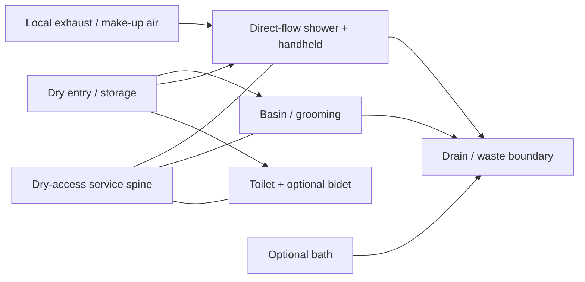
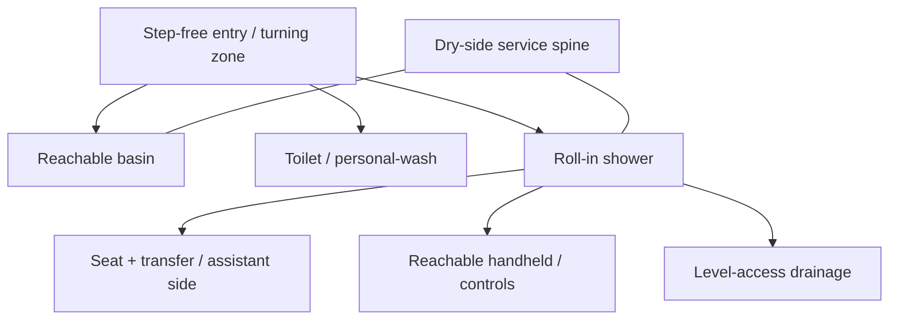
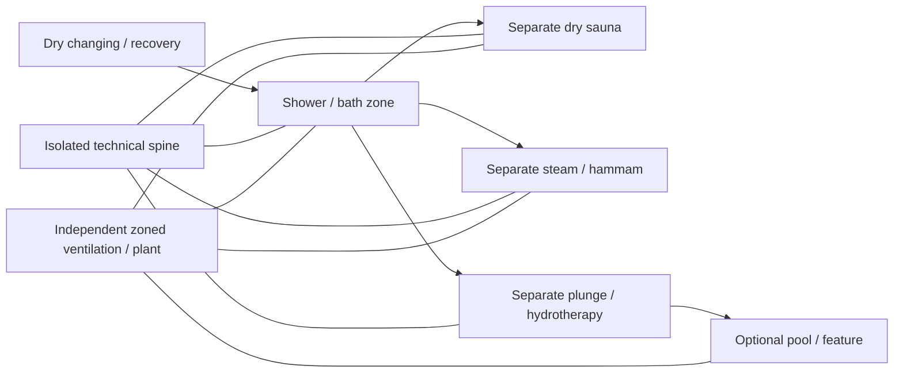
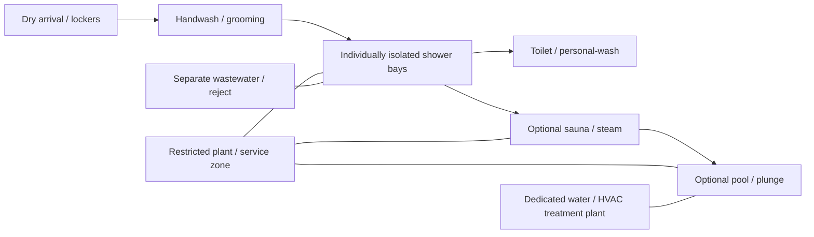

# Luminous Aqua — Reference Room Archetypes and Spatial Design v0.1

**Status:** conceptual reference layouts; not dimensioned construction drawings  
**Parent:** [AQUA-BATHING-SERVICE-001 #12660](https://github.com/Luminous-Dynamics/symthaea/issues/12660)  
**Room integration:** [AQUA-WETROOM-ENVELOPE-001 #12702](https://github.com/Luminous-Dynamics/symthaea/issues/12702)  
**Fixture modules:** #12692 shower, #12693 washstation, #12694 thermal suite  
**Evidence interfaces:** [AQUA-OWNER-INTEGRATION-MAP-V0_1.md](AQUA_OWNER_INTEGRATION_MAP_V0_1.md)

## 1. Design principle

Design the bathroom as a user journey and a maintainable building-service assembly, not a row of expensive fixtures.

Every room archetype should optimize five interacting paths:

1. **Human path:** enter, change, reach, transfer, bathe, wash, exit and recover.
2. **Water path:** source, fixture, drainage, optional separately treated non-potable end use and lawful reject.
3. **Thermal path:** hot-water generation, storage, fixture delivery, indirect recovery and room conditioning.
4. **Air/moisture path:** source capture, ventilation, pressure hierarchy, vapor control, drying and condensate.
5. **Service path:** isolate, inspect, clean, replace, requalify and return to service without dismantling the finished room.

No single plan is assumed to fit every household, climate, tenure, disability profile or cost envelope. The following four archetypes define composable reference patterns.

## 2. Archetype A — compact essential bathroom

**Purpose:** affordable, repairable household hygiene in a constrained footprint. This is the recommended first residential configuration to productize; it is not a luxury room reduced in size.

### Layout logic

- Dry entry and towel/garment storage remain outside the main spray envelope.
- Basin and mirror sit near the entrance for quick handwashing / grooming with minimal path crossing.
- Shower is a direct-flow baseline with a fixed head plus handheld option, mechanical shutoff and reachable thermostatic control.
- Toilet and bidet/personal-wash device are a distinct fixture supply/use profile; backflow protection and service access are not hidden in the wall.
- A single accessible service spine backs onto the wet wall where site geometry allows: isolation, valves, strainers, meters, trap inspection and indirect drain-heat exchanger.
- Any bathtub is optional and only included if it does not undermine circulation, transfer or service access.

### Required design tradeoffs

- Prefer robust, standard-size service parts over unusual integrated electronics.
- Use a low-flow spray geometry only when task/coverage test passes at local low pressure.
- Do not include in-session recirculation in the first product unless separate hygiene and exposure qualification exists.
- Provide natural/low-energy drying where safe and feasible, with local mechanical extraction for moisture and aerosol control.
- Keep the room locally operable if internet, cloud or Symthaea is unavailable.

### Reference adjacency

## 3. Archetype B — accessible all-age bathing room

**Purpose:** enable independent or assisted bathing across a wider range of mobility, reach and sensory requirements. Accessibility is a spatial and service-path property, not a grab-bar product option.

### Layout logic

- A continuous step-free route connects entry, basin, shower and toilet/personal-wash.
- Provide a roll-in / low-threshold shower option with seat, handheld spray, reachable controls and a clear transfer/assistant side.
- The basin is reachable from a seated position and does not require entering the spray zone.
- Shower seat and grab-bar anchorage are structurally designed and professionally reviewed; decorative suction fixtures are not assumed load-bearing.
- The door, towel, storage, controls and emergency shutoff do not obstruct the transfer and egress path.
- Provide contrast, legible mechanical controls, glare control, acoustic consideration and predictable temperature response.
- Where a bath is selected, compare an accessible step-through or transfer-compatible vessel as a separate product profile; do not place it where it blocks the shower transfer zone.
- Avoid mandatory smartphone, voice or camera control.

### Testable user journey

Approach -> enter -> reach control -> transfer / sit -> wash -> reach handheld / soap / towel -> drain -> exit -> dry / recover.  
A layout is not labelled accessible until exact dimensions are checked against controlled standards and applicable local requirements, then user-tested with appropriate safeguards.

### Reference adjacency

## 4. Archetype C — premium restorative / thermal suite

**Purpose:** compose shower, bath, dry sauna, steam/hammam, cooling and recovery into a deliberately zoned suite. A premium experience does not justify merging dissimilar water or air systems.

### Layout logic

- Dry changing/recovery room at the entry, with seating, storage and towel provision.
- Shower / bathing zone with direct-flow and bath options, plus separately serviceable fixtures.
- Dry sauna as its own thermal enclosure with independent heater safety, clearances, ventilation and egress.
- Steam/hammam as a separate vapor-loaded enclosure with its own waterproofing, vapor-control, condensate, generator and dry-out path.
- Cold plunge / whirlpool / hydrotherapy as a separate immersion-water process and exposure class with dedicated treatment, sampling and maintenance.
- Optional pool or water feature is delegated to Sol-Atlas #765/#766/#770/#772 for finite thermal, evaporation and microclimate evidence; room/HVAC design follows the natatorium-specific owner and qualified review.
- Service access is outside the user circulation path, with isolation and drainage visible and labelled.

### Heat / air design

- Compare a heat-pump storage DHW baseline, mixer-side drain-heat recovery, tank-side DWHR and hybrid topology using the full system benchmark.
- Dry sauna air, steam-room air and pool/natatorium air must not share an unqualified return/exhaust path.
- Use a mode profile for each environment: startup, occupied, post-session purge/dry-out and return-to-ready.
- Do not claim a pool or water feature is an infinite heat sink; the pool remains finite and demand-limited.

### Reference adjacency

## 5. Archetype D — shared / community / hospitality bathing facility

**Purpose:** design for multiple users, high duty cycles, cleanability, privacy, maintenance access and operational continuity.

### Layout logic

- Separate dry changing / lockers, handwash basins, shower bays, toilets/personal-wash and aquatic/thermal zones.
- Provide a clear one-way circulation option where privacy and access permit; avoid wet traffic crossing the clean/dry circulation.
- Each shower bay has an individually isolatable fixture and serviceable spray/nozzle cartridge.
- Shared shower systems are not allowed to carry a stored recirculated volume between users without a completely separate, independently qualified exposure regime. Default to direct-flow and indirect heat recovery.
- Cleaning closets, chemical storage, filter service and waste/reject points are separated from user access and ventilated as required.
- Aquatic treatment plant and chemical handling have controlled access; pool water, spa water, shower potable supply and wastewater remain distinct.
- Provide plant redundancy and a repair plan that does not require closing all essential bathing services for a single fixture fault.
- Privacy, acoustic separation, lighting and supervision requirements are declared by facility type rather than inferred by cameras.

### Reference adjacency

## 6. Shared modular interface kit

The room family should use common *interfaces* without forcing identical fixture hardware:

| Interface | Standardized product boundary | Domain authority |
|---|---|---|
| Potable supply | pressure/temperature/flow envelope, isolation and sample access | qualified plumbing + Mycelix metrology |
| Fixture delivery | model/geometry, flow, spray/task and temperature profile | Aqua fixture module |
| Waste / drain | drainability, cleanout, overflow, reject and lawful discharge route | qualified plumbing + Symtropy resource closure |
| Indirect heat recovery | receiver-side useful heat, pressure loss, bypass and fouling evidence | Symtropy thermal/resource owners |
| Electrical | local isolation, earthing/bonding, wet-location protection and device-specific supply | qualified electrical design |
| Ventilation / moisture | mode-specific airflow, pressure, dew point, condensation and dry-out | qualified HVAC/envelope owners |
| Accessibility | reach, transfer, turning, support anchorage, egress and task path | controlled standards + local professional / user review |
| Maintenance | tool access, replacement, cleanout, requalification and downtime | Aqua serviceability contract |
| Evidence | versioned owner receipts, uncertainty, source/configuration identity and claim ceiling | Mycelix + Luminous Platform |

## 7. Design and benchmark release gates

1. **User / task gate:** declared archetype, intended users, tasks, accessibility profile and exclusions.
2. **Spatial gate:** exact room geometry, dimensions and clearances checked against controlled standards and local requirements.
3. **Utility gate:** potable, same-session recirculation, greywater, pool/immersion and wastewater circuits physically mapped and reviewed.
4. **Thermal / air gate:** hot-water, DWHR, ventilation, pressure, moisture and condensation model interfaces frozen.
5. **Service gate:** each wet component has isolation, cleanout, inspection, replacement and requalification access.
6. **Unoccupied bench gate:** all relevant simultaneous modes and fault states tested in Symtropy #4531.
7. **Human factors gate:** representative task users and accessibility profiles assessed only after safety and ethics review.
8. **Deployment gate:** local plumbing, electrical, drainage, fire, accessibility, water-quality and building reviews accepted before occupied construction or pilot.

## 8. Standards and local context

- ISO 21542:2021 is an international accessibility/usability design reference; use the controlled edition and applicable local rules for dimensional details: https://www.iso.org/standard/71860.html
- SANS 10400-S is a relevant South African built-environment accessibility reference; verify current edition/status, clauses and local adoption through SABS and qualified building professionals.
- SANS 10252-1:2016 Edition 3.1 is the currently identified South African water-supply-installation reference in this research packet; verify the current controlled SABS catalogue before design or compliance claims.
- Johannesburg Water Services By-laws 2023 sections 74 and 106A are relevant to stored greywater and pool backwash/discharge; local professional review must confirm current requirements for each site.
- ASHRAE natatorium guidance applies to indoor pool/high-dew-point rooms, not automatically to ordinary bathrooms, dry saunas or steam rooms.

## 9. Claim ceiling

These archetypes are conceptual spatial patterns, not dimensioned designs, P&IDs, construction drawings, accessibility certification, building approval or proof of user outcomes. No human trial, purchase, procurement or construction is authorized by this document.

## 10. Bathing fountains and water-feature distinction

Treat human-contact water features as distinct product/process classes:

| Class | User contact | Product boundary | Core design implications |
|---|---|---|---|
| Decorative / non-contact fountain | none intended | landscape / visual water feature | prevent unintended entry; separate service and drainage; landscape water-quality and maintenance rules |
| Interactive spray / bathing fountain | water spray/jets contact users; no standing water in activity zone | spray/play venue; single-pass or recirculated | spray/impact, aerosol, slip, drainage, runoff, source, backflow, collection tank and treatment differ by system |
| Immersive bathing / hydrotherapy pool | standing/captured water | aquatic venue / pool or spa | turnover, filtration/disinfection, residual, sampling, egress, maintenance and water budget |

CDC's 2024 fifth-edition MAHC defines interactive water-play venues as sprayed/jetted features where water contacts bathers whether single-pass or recirculated. The MAHC is public aquatic-venue model guidance, not automatically local law. CDC warns that decorative fountains entered by the public should either be managed as splash pads or be protected from entry. The category must be identified before a water feature is designed or operated for bathing.

Sources:
- https://www.cdc.gov/model-aquatic-health-code/php/our-work/index.html
- https://www.cdc.gov/model-aquatic-health-code/media/pdfs/2024/11/5th-Ed-MAHC-Code-508.pdf
- https://www.cdc.gov/healthy-swimming/toolkit/operating-public-pools-hot-tubs-and-splash-pads.html

Sol-Atlas #765/#766/#770/#772 retains pool and landscape water-feature thermal / evaporation / microclimate modelling. Aqua owns only user-facing bathing task, feature geometry, access and room integration. Mycelix #6100 remains the water-use assessment authority.
