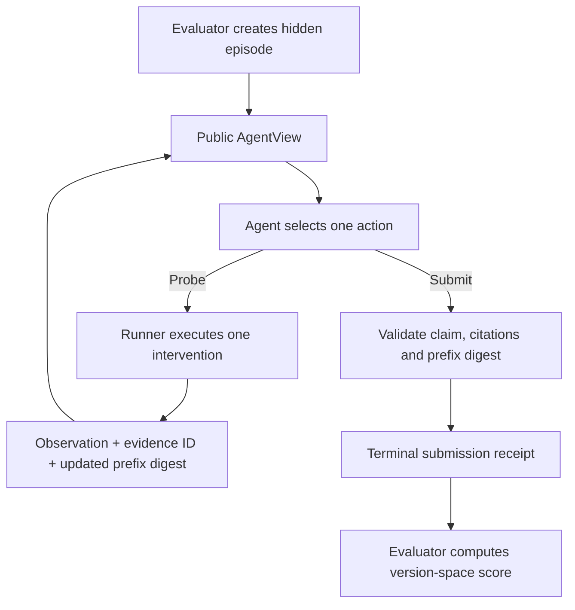

# Blind open-world research episode protocol v0

Date: 2026-11-08  
Status: executable protocol implementation in draft PR #11060; no agent-performance result claimed.

## Purpose

The three reference worlds now have a common agent-facing interaction contract. This closes the gap between evaluator-side synthetic simulators and a future agent adapter. The interface gives the agent a public task manifest, a bounded intervention API, returned observations, and a terminal structured claim. It does not give the agent the generating model or evaluator oracle.

## Protocol loop

The agent receives only `AgentView` and returns `AgentAction` values. A probe consumes one budget unit and produces one observation. A submission closes the episode. The runner rejects wrong-family interventions, out-of-budget probes, unsupported hypotheses, duplicate model claims, malformed dispositions, duplicate or unknown evidence references, and stale evidence-prefix digests.

## A0/A2 treatment integrity

The public manifest identifies the treatment:
- **A0:** one correct structural family is supplied; the parameter, initialization and sensor values remain hidden.
- **A2:** the structural family is withheld.

Evaluator constructors reject an A0 manifest whose supplied structure does not match the generating world's actual structure. A0/A2 agents must receive matched observation budgets, task seeds, interventions and environment parameters for a valid comparison. This protocol does not itself perform that randomization or seed assignment; the external benchmark harness must own it.

## Evidence binding

Each returned observation receives a monotonically assigned evidence ID (`E0001`, ...). The agent cites only IDs it actually received. Every submission must echo the SHA-256 evidence-prefix digest returned by the latest view. The evaluator verifies that the digest matches the exact task/observation prefix at submission time.

The digest is computed over the v0 Rust `serde_json` serialization of the public task and observation list. It is a versioned protocol digest, not an assertion that arbitrary JSON serializations from every programming language will hash identically. Cross-language harnesses should echo the digest rather than independently reconstruct it until a canonical cross-language serialization is standardized.

## Claims and scoring

A claim is a set of compatible typed hypotheses plus one disposition: identified, ambiguous, no-compatible-model, or abstain. It is not forced to nominate a single equation when the evidence leaves multiple models compatible.

After submission, the trusted runner can compute:
- exact version-space match;
- claimed/oracle/intersection counts (supporting precision and recall calculation);
- disposition correctness;
- evidence-reference validity;
- action count and cited-evidence count.

The score is evaluator-side and must not be returned to the agent before submission. The agent process must be isolated from the runner process. The Rust type boundary and private evaluator state are not an operating-system security sandbox.

The evaluator uses separate trace-filter implementations and does not call the agent-facing `discover()` or `predict()` functions. It shares the typed candidate-family definitions, but independently recomputes which members fit the observed trace. Differential tests compare evaluator and inference results over every candidate model in all three finite worlds; negative controls verify that omitted or incompatible claimed models do not pass exact-set scoring. This is implementation-level independence, not a fully independent benchmark implementation or external oracle.

## Executable coverage

The protocol module covers the boolean hidden-lag world, numeric direct/leaky-memory world, and two-input interaction world. Tests cover:
- no truth-field serialization in A2 AgentView;
- intentional disclosure of supplied structure in A0 without disclosing sensor truth;
- one-step budget accounting and terminal submission;
- wrong intervention family rejection;
- supported-model and evidence-reference validation;
- exact-prefix binding and stale-prefix rejection;
- matched A0 structure validation;
- full-factorial interaction episodes and evaluator scoring.

## Finite enumerator reference policy

`policy::FiniteEnumeratorBaseline` consumes only `AgentView` values and emits one probe or a terminal submission. It uses exact consistency filtering over the declared finite model family and the finite partition heuristic. This provides a transparent reproducible reference against which the learned Symthaea research policy can be compared; it is not itself learned and does not demonstrate scientific discovery beyond the finite grammar.

Its current policy tests exercise paired numeric A0/A2 episodes using the same generating model and probe budget, plus a full-factorial interaction discovery episode. This is a test harness for the protocol and baseline, not a reported benchmark score.

## Current limitations / next falsifiable milestones

This is an interface and protocol-conformance layer, not an evaluated research agent. The evaluator score currently uses an exact finite candidate set; it is not yet a probabilistic posterior score, decision-focused EVSI, or a continuous-world verifier. It does not add stochastic noise, drift, saturation, unknown delay, hidden spatial state, adaptive instrument selection, or external paper-derived tasks.

Next milestones:
1. Connect a Symthaea research-policy adapter that consumes only serialized AgentView messages and emits AgentAction messages.
2. Freeze the incumbent policy/config and preregister A0/A2 runs with evaluator-owned seeds.
3. Compare random, fixed-grid, partition-maximizing, entropy and decision-focused EVSI policies under the same inclusive budget.
4. Add noise and instrument transformations with proper scoring rules and calibration.
5. Replicate one external benchmark task family before making any cross-benchmark performance claim.
