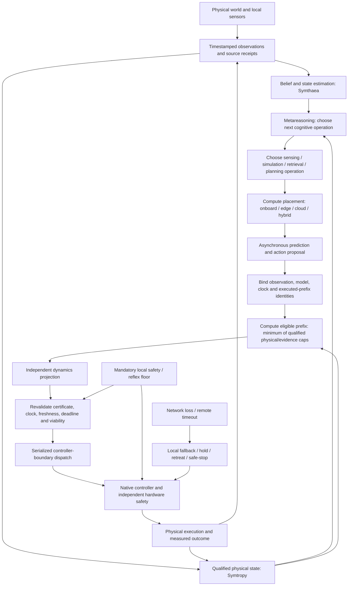

# Integrated thermodynamic cognitive robotics decision stack

Status: architecture/evaluation contract; no deployed controller or safety certification is claimed.

Related research owners:
- #11496 FEP + physical thermodynamics benchmark;
- #11561 real-time cognition with a moving world;
- #11573 onboard / edge / cloud placement benchmark;
- #11581 viability- and thermodynamics-constrained action commitment horizon;
- #5468 metareasoning fabric;
- #3351 computational metabolism / value of compute;
- #9010 world-model value-add;
- #11122 decision-focused EVSI;
- #11338 distributionally robust active sensing;
- Symtropy #4117 certificate validity, #4382 action projection, #2836 controller dispatch, #4044 energy boundary, #4179 actuator loss, #4206 actuator dynamics, #4610 thermal state, #4588 observation-constrained mobility, #4511 recovery topology.

## One robot, four different decisions

Keep these decisions distinct. They have different inputs, outputs, evidence requirements and owners.

| Decision | Question | Owner / consumer | Output |
|---|---|---|---|
| Cognitive operation | What internal computation or observation is worth doing next? | Symthaea #5468/#3351, with #11122/#11338 | Operation proposal, expected decision value, resource budget |
| Compute placement | Where should this optional computation run? | Symthaea #11573 benchmark; runtime uses existing metareasoning/placement implementation | Onboard/edge/cloud/hybrid candidate or local fallback |
| Commitment horizon | How many actions can remain committed before the next observation/replan? | Symthaea #11581 | Maximum eligible action prefix |
| Physical authorization | Is this exact proposal valid, projectable, viable and dispatchable now? | Symtropy #4117/#4382/#2836 plus native platform safety | Accept/reject with reason; controller outcome |

Do not compress these into one mega-agent or one scalar score. A high EVSI cannot override a thermal cap. A powerful edge GPU cannot extend action expiry. A feasible prefix does not authorize execution. A controller-boundary permit cannot prove the world model was decision-useful.

## End-to-end flow

This diagram describes the evaluation boundary, not a claim that all edges are implemented. Local reflexes, hard real-time control, emergency stop and safety interlocks are non-auctionable and remain available without edge/cloud inference.

## Cognitive quantity versus physical quantity

Symthaea's variational/expected free energy remains an inference and policy-evaluation construct. Physical energy, thermal state, entropy generation and exergy destruction remain in Symtropy's declared physical system boundaries. Information gain in bits/nats is not J/K. Neither FEP scores nor entropy metrics authorize actuation.

## Action proposal identity and temporal coherence

Every asynchronous proposal/chunk must be bound to:
- policy/model digest;
- source observation digest and clock domain/epoch;
- bounded clock mapping and observation age interval;
- exact committed/executed-prefix digest and next action index;
- generation, intended application and expiry intervals;
- task deadline and action horizon;
- physical model, calibration and uncertainty-envelope identity.

A returned remote result is not trusted because it is newer or came from a faster GPU. It must match local state, clock and model evidence at application time.

## Commitment horizon is a bottleneck, not a weighted score

A positive horizon is computed only when all required caps are qualified and composable on one canonical context:

`N_commit = min(N_proposal, N_freshness, N_deadline, N_risk, N_thermal, N_actuator, N_dynamics, N_viability, N_queue, N_continuity)`

Every cap must:
1. be finite and integer-valued in the same control-tick unit;
2. bind the same state/action/model/uncertainty/clock/calibration/control-period context digest;
3. be prefix-closed, i.e. every intermediate tick through the cap meets the constraint;
4. carry a source receipt and validity interval;
5. preserve explicit ties among binding constraints.

Unknown, stale, digest-mismatched, non-prefix-closed or differently scoped caps block new-prefix eligibility. Zero means no new prefix. The selected horizon is a maximum eligibility limit; a policy may choose a shorter horizon but may never exceed it.

After selection, the entire candidate prefix still passes independent projection, certificate revalidation, viability/RTA and serialized controller dispatch. The horizon function itself never returns an actuator permit.

## Distributed inference and thermodynamic boundary

Onboard/edge/cloud are alternative placements for optional cognition, not alternative control authorities.

The end-to-end budget includes capture, encoding, uplink, queue, inference, downlink, decoding, local freshness checks, projection, RTA, dispatch and actual command response. Robot battery draw, radio energy, edge/cloud compute and facility overhead are separate accounting terms. If edge/cloud energy is unmeasured, whole-system energy benefit is Unknown even if robot battery endurance improves.

## Experimental factorization

Do not run one giant Cartesian sweep immediately. Use staged matched experiments:

1. **Model/policy:** direct policy, Bayesian/set-membership, MPC/HQP, robust MPC, FEP, generative WAM.
2. **Execution:** synchronous hold, fixed-K async, progress-triggered TempoWAM-style replan, AHA-WAM temporal decoupling, Streaming-WAM committed-prefix conditioning, Reuse-then-Refine, bottleneck horizon.
3. **Placement:** onboard, lightweight onboard, edge, cloud, hybrid, fleet-shared.
4. **Evidence/decision:** fixed sensing, EIG, EVSI, distributionally robust EVSI, dual-control.
5. **Physical envelope:** nominal, thermal stress, actuator derating, contact ambiguity, sensor bias/clock uncertainty, sequential faults.

Start with one factor at a time, then pre-register a small interaction design around the strongest effects. Match task/plant/action limits, data, observation opportunities, model capacity, wall-clock deadline, hardware and safety gates. If model capacity or training differs, report it as a separate factor.

## Primary claim

The strongest defensible contribution is not that FEP, WAMs, edge compute or entropy reduction is universally superior. It is that a composable system improves held-out real-time safe service and recoverability under matched budgets, because it knows:
- what it should compute next;
- where that computation should run;
- how long it can safely commit before observing again;
- whether the exact action remains valid and physically admissible when it is applied.

A negative result for any component is useful and should simplify the architecture.

### Separate probabilistic-risk and robust-viability gates

Symtropy #4010 supplies one-step chance constraints; #4232 preallocates non-recyclable finite-horizon family-wise risk; #4588 supplies robust observation-constrained viability. The commitment cap consumes the contiguous prefix with already allocated per-step/per-constraint risk (`N_risk`) separately from the set-based robust viability prefix (`N_viability`). Never recycle skipped or consumed alpha, never reuse one-step alpha at every footfall, and never treat a chance bound as a robust reachability proof. Both gates are required where the operating profile declares both.
